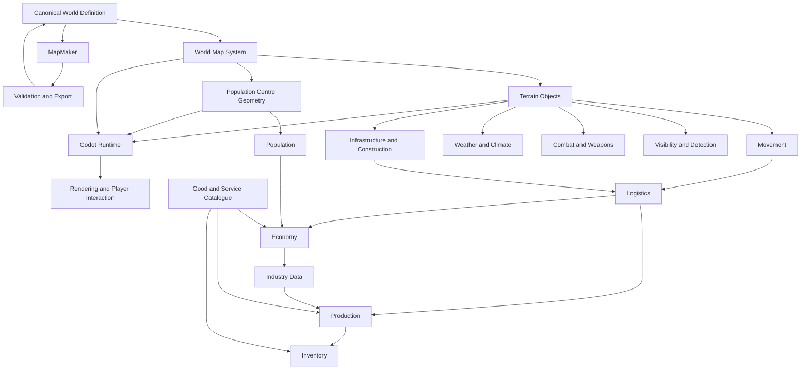

# World Map and Simulation Dependency Map

**Canonical Path:** `technical/architecture/world-simulation-dependencies.md`  
**Document Type:** Technical Architecture Reference  
**Status:** Foundational Architecture Reference

---

## 1. Purpose

This document records the principal ownership boundaries and dependency relationships for the World Map, Terrain Objects, Population Centres and the simulation systems that consume them.

It is a navigation and integration reference. It does not replace the canonical rules in the owning system specifications.

## 2. Canonical Documents

| Concern | Authoritative document |
| --- | --- |
| Shared geographic model, coordinates, spatial queries and Movement Grid | `systems/world/world-map-system.md` |
| Physical unit/platform/carrier movement, route traversal and transportation | `systems/world/movement-and-transportation-system.md` |
| Actual weather/climate state, environmental events and forecasts | `systems/world/weather-and-environment-system.md` |
| Terrain Object model, attributes, states and initial type catalogue | `systems/world/terrain-objects.md` |
| Population Centre geography, civilian demographics, cohort accounting, migration and population state | `systems/population/population-centres-system.md` |
| Population assignments, event ledger, composition, spatial distribution, labour/education, needs and interest-profile schema | `technical/data-schemas/population-schema.md` |
| Map authoring architecture and Godot integration | `technical/map-authoring/mapmaker-specification.md` |
| Financial state and transactions | `systems/economy/economy-system.md` |
| Industry Types and establishment configuration | `systems/economy/industry-data.md` |
| Production facilities, orders, capacity and execution | `systems/production/production-system.md` |
| Production transformations and recipes | `systems/production/production-processes-and-recipes.md` |
| Physical stock, holdings, reservations and inventory movements | `systems/inventory/inventory-system.md` |
| Canonical Goods, Services, product classes and units | `reference/economy/good-and-service-catalogue.md` |

A document may link to another specification, but must not copy its rules as a competing authority.

## 3. Authority Model

The architecture separates geographic truth, mutable simulation state, and derived data.

| Data | Authority | Examples |
| --- | --- | --- |
| Geographic definition | World Map / canonical world data | Geometry, altitude surface, feature IDs |
| Terrain definition | Terrain Objects | Road type, forest type, base height, supported states |
| Current terrain condition | Owning simulation system | Flooding, freezing, damage, repair progress |
| Settlement geometry | World Map and Population Centres | Population Centre Area and settlement class |
| Population and demographics | Population | Civilian totals and cohorts, residence/displacement assignments, labour supply, education, needs/fulfilment, wellbeing and composition distributions |
| Financial state | Economy | Cash, prices, revenue, expenditure, tax transactions |
| Industry configuration | Industry Data | Industry Type, establishment profile, location requirements |
| Production state | Production | Facility, capacity, order, execution |
| Physical stock | Inventory | Stock lot, quantity, location, reservation, movement |
| Product identity and units | Good and Service Catalogue | `catalogue_id`, class, canonical unit |
| Physical unit/platform/carrier position and route traversal | `systems/world/movement-and-transportation-system.md` | Current position, movement mode, traversal progress, arrival and interruption events |
| Supply demand, shipment coordination and delivery reconciliation | Logistics | Demand, allocation, cargo manifest, shipment lifecycle and delivery status |
| Rendering and derived caches | Runtime/build pipeline | Meshes, visual layers, cell samples, spatial indexes |

A system may cache another system's data for performance, but cached copies must be invalidatable and must not become authoritative.

## 4. Dependency Graph

This graph represents conceptual dependencies, not a required runtime call order. The global scheduler and each owning specification determine when state changes are applied.

## 5. Integration Contracts

### 5.1 World Map to Terrain Consumers

World Map supplies spatial queries, geometry, altitude, grid addressing and stable feature references. It does not return a universal movement cost, detection probability or weapon effect.

Movement, Visibility and Detection, Combat, Logistics and Construction evaluate geographic facts using their own rules.

### 5.2 Terrain Objects to Simulation Systems

Terrain Objects supply type, geometry, base physical attributes and supported Terrain States. The owning simulation system applies the relevant state transition and calculates its effects.

For example, Weather may trigger a road becoming muddy; Movement evaluates the road's current condition. Combat may damage a bridge; Infrastructure and Engineering determine repair. Rendering only communicates the committed state.

### 5.3 Population Centres to Population

Population Centre geometry supplies the settlement footprint and spatial identity. Population owns civilian population totals, single-year age cohorts, births/deaths, migration and displacement accounting, labour eligibility and availability, dependants, education, needs, fulfilment reconciliation, wellbeing indicators, social/cultural distributions and demographic change. Population uses aggregate counts by default, with spatial distribution represented separately from built-up intensity.

A Population Centre's displayed population is a Population-owned value associated with a stable geographic ID. It is not derived from polygon area unless an explicit scenario-generation or demographic model requires an initial estimate. Cohort counts must reconcile to population totals; committed population-changing events must be applied once; residence, citizenship, sovereignty, territorial control and administrative jurisdiction remain separate. Labour eligibility is not employment, a job offer is not an employment assignment, and education-service availability is not proof of attendance or completion. Population needs distinguish requirement, request, allocation, delivery, access, confirmed consumption and shortfall. Population does not infer consumption from production, purchase, shipment or stock existing somewhere in the economy.

The Population System follows the shared scheduler and defines a local logical update contract. Civilian-harm effects are calculated by Combat and Weapons and supplied as committed, idempotent events; Population applies the demographic consequences once. Wellbeing indicators are descriptive unless another owning system defines an explicit causal rule. National reporting distinguishes residence, citizenship, jurisdiction, legal sovereignty, effective control, displacement status and in-transit assignment.

### 5.4 Population and Catalogue to Economy

Population need definitions reference canonical Catalogue IDs and explicit quantities/units. Catalogue defines product identity and unit semantics. Population defines demand and consumption interval. Economy defines prices, affordability and financial transactions. Inventory and Logistics determine physical availability and movement. Production determines production execution.

A stated need is not proof that a good has been produced, purchased, delivered or consumed.

### 5.5 Geography to Industry and Production

An Industry or production facility may reference a geographic location or feature. Geographic proximity does not itself create an Industry, assign labour, grant resource access, establish production capacity or generate output.

Industry Data defines establishment configuration. Economy owns establishment costs and financial movements. Production owns facilities, capacity, orders and execution. Inventory owns physical stock. Logistics owns shipment and delivery.

### 5.6 Physical Infrastructure and Logistics

Roads, railways, rivers and crossings provide geographic features for transport-network construction and traversal. The World Map owns geometry; Terrain and Environment provide relevant physical state; Infrastructure owns shared facility identity, condition, capabilities and generic capacity definitions; Movement/Transportation owns actual unit, platform and carrier traversal, movement progress, route feasibility and arrival/interruption events under `systems/world/movement-and-transportation-system.md`; Logistics owns supply route choice, shipment/cargo lifecycle coordination and delivery reconciliation; Inventory owns physical cargo quantities and stock transitions.

The Movement and Transportation behavioural specification is now canonical, but detailed schemas, mode calibration and conformance tests remain open. The specification's existence is not a claim that movement simulation is implemented.

The existence of a road line does not guarantee that it is connected, passable, maintained, available to a particular transport mode or operational in its current state.

## 6. Change Propagation

A change to World Definition may invalidate derived spatial data. It must not silently overwrite runtime World State or existing save data.

A change to a Terrain Object definition may affect movement, visibility, combat, infrastructure and rendering previews. Such changes require versioning and compatibility review where saved state or scenarios depend on the prior definition.

A change to Population Centre geometry may affect spatial queries and displayed settlement boundaries. It must not silently change Population Total or duplicate people. If geometry edits require demographic reallocation, that must be an explicit migration or scenario operation.

A change to a Catalogue entry, unit definition or recipe must not rewrite historical economic or production records. Existing cross-system invariants continue to apply.

## 7. Questions Requiring Later Technical Decisions

The following decisions must be resolved by the relevant Technical Specification before implementation contracts are frozen:

- canonical coordinate reference, projection, precision and world bounds;
- geometry serialization and supported topology rules;
- stable ID format and namespace policy;
- exact Movement Grid indexing and edge-cell handling;
- altitude data representation and slope sampling;
- versioning and migration of World Definition;
- save-game references to world-data versions;
- event delivery and scheduler ordering for state changes;
- cache invalidation and deterministic rebuild requirements;
- whether terrain visibility remains linear per 100 metres or adopts a richer model;
- storage and performance strategy for large worlds;
- authoritative representation of urban density, buildings and settlement damage.

These questions should be resolved centrally. Individual systems must not make incompatible assumptions while they remain open.

## 8. Acceptance Criteria

This dependency reference is conformant when each major data domain has a clear authority, cross-system references use stable IDs, derived data can be rebuilt, and no system duplicates the authoritative financial, demographic, production, inventory or geographic state of another system.

## Additional Foundational Domains

The following specifications extend the world and simulation ownership model:

- `systems/world/national-territory-and-control-system.md` owns national territory and claims, political boundary status, effective territorial control, frontline derivation, contested areas, and occupation status.
- `systems/infrastructure/installations-and-facilities-system.md` owns the common installation/facility model, facility capabilities and capacity, physical condition, and the integration contract for military and economic sites. Domain systems continue to own their specialised rules.
- `technical/map-authoring/mapmaker-art-and-asset-specification.md` owns MapMaker visual asset requirements, terrain patterns, transparency/masking, state variants, zoom-dependent labels, and display-layer contracts. It does not own simulation state.

### Political and Military Spatial State

The World Map System owns canonical coordinates, geometry, spatial indexing, and spatial queries. The National Territory and Control System owns political meaning and territorial control state. Movement/Transportation provides authoritative continuous unit/platform/carrier positions, route traversal and movement events under `systems/world/movement-and-transportation-system.md` (MOV-TRANS-001); implementation and conformance remain open. Logistics coordinates supply route choice, shipments and delivery but does not duplicate physical traversal state. Military Systems provide unit identity, formations, orders, and operational presence; the territory system derives or records control using explicit rules. National borders must not be treated as frontlines, and a frontline must not automatically change legal sovereignty.

### Installation and Facility State

The World Map System owns the spatial location and footprint geometry of installations and their sub-features. The Installations and Facilities System owns canonical Facility identity, composition, shared declared capabilities and generic capacity definitions, ownership/operator/control references, and shared physical condition/lifecycle. Production references the canonical Facility ID and owns production-specific process capability mappings, process/output-basis throughput definitions and calculations, production-line scheduling, capacity allocation, orders and execution state. Production must not duplicate the Facility identity or its shared generic capacity and physical state. Inventory, Logistics, Military Systems, Movement, and specialised infrastructure systems own their respective stock, transport, unit state/positions and traversal, runway/port operations, repair and other domain calculations.

### Rendering Contracts

MapMaker and the runtime renderer consume world geometry and state from authoritative systems. They may derive labels, symbols, clusters, visual overlays, and simplified zoom representations, but these are presentation products. Company ownership, national sovereignty, military control, occupation, and facility operation are separate facts and must remain distinguishable in both data and visualisation.

## Command Ops 2 Dependency and Reassessment Contract (2026-10-27)

The dependency graph must model both data dependencies and causal state transitions. Command is a consumer of relevant domain information and the owner of operational decisions, not a substitute for World, Terrain, Movement, Communications, Combat, Logistics or Inventory.

- World Map provides canonical spatial identity and geometry; Terrain/Infrastructure provide physical feature state; Environment provides actual conditions and forecasts; Movement calculates route feasibility and owns physical progress.
- Sensors owns observations/tracks; Intelligence owns reports and assessments; Communications owns message delivery; Command consumes only information available to its actor and owns resulting orders/plans.
- Combat owns engagement effects; Logistics owns supply demand/shipment coordination; Inventory owns physical stock and transactions; Economy/Government/Production/Research own their defined financial, approval, execution and knowledge transitions.
- A producer emits a state-change event or exposes a versioned authoritative query. Consumers recalculate only the affected derived state and emit their own owned transitions; no downstream consumer writes back into an upstream authority.
- Material changes may invalidate a derived plan, route, ETA or readiness estimate. Reassessment triggers must be explicit and coalesced, and a trigger does not itself amend an order.
- Dependency cycles must be resolved through requests/events and scheduled subsequent updates, not recursive same-tick mutation. Event ordering for simultaneous movement, combat, supply receipt and damage remains an explicit scheduler contract.
- Derived route, ETA, readiness, supply sufficiency and operational-picture values retain source/version/time references so they can be recomputed and explained.

Required tests: route invalidation propagates through Movement and Logistics to Command without recursive mutation; one physical-state event produces one downstream transition per owner; simultaneous event ordering is deterministic; hidden authoritative state is not exposed to actor planning.
